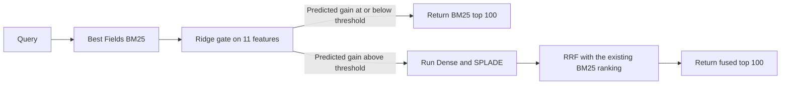

# Conditional Hybrid Retrieval under Recall Budgets

## An Indexed Cascade Study

**Authors:** Ali Omar, Abdallah Mestrah, and Abbas Yazbek  
**Supervisor:** Dr. Ahmad Abboud  
**Affiliation:** Lebanese University

Research project report. Completed experimental scope, 21 October 2026.

## Abstract

Hybrid retrieval combines different search methods, but running every method for every query can be costly. We first implemented a Blended RAG-inspired hybrid baseline in Python and evaluated it on TREC-COVID and SQuAD, then added indexed BM25 and a BM25-first gate. On all 50 TREC-COVID queries, the primary indexed cascade was 20.21x faster than our earlier fusion baseline across separate runs, retaining 96.68% of the indexed fusion Recall@100. Of this, indexed fusion alone was 16.36x faster than the earlier baseline, while routing added 1.24x over indexed fusion. On a fixed sample of 256 SQuAD questions, the fastest indexed cascade was 7.91x faster than our earlier fusion baseline; it was 1.59x faster than indexed fusion and retained 99.22%. These comparisons are within our implementation; they are not direct measurements against the original paper system. The study indicates that indexing and conditional routing may transfer to the original system, but that requires testing with Elasticsearch and ELSER.

**Keywords:** hybrid retrieval, conditional computation, BM25 indexing, recall retention, retrieval evaluation.

## 1. Original paper and research context

Sawarkar, Mangal and Solanki's *Blended RAG* combines keyword, dense-vector and learned-sparse retrieval in Elasticsearch [1]. It uses ELSER for learned sparse retrieval and reports both retrieval scores and generated-answer scores. Its published TREC-COVID and SQuAD numbers are reference results; this project did not reproduce those measurements. CoQA is discussed in the original paper, but was not evaluated here.

We ask whether every query needs all retrieval branches. We first implemented a Python baseline inspired by the hybrid retrieval approach presented in Blended RAG, using MiniLM, SPLADE and reciprocal rank fusion (RRF), and evaluated it on overlapping datasets. We then added indexed BM25 and conditional routing. This is a methodological adaptation, not a reproduction of the original Elasticsearch and ELSER system. The measured speedups therefore compare stages of our own implementation; they do not establish speedup on the published system.

Query-dependent retrieval choice has been studied before [2], as has moving BM25 scoring work into index construction [3]. We do not claim these ideas as new. Instead, we measure how a frozen query gate behaves with a compatible indexed BM25 implementation on the collections and settings described below.

## 2. Motivation and contribution

A cascade saves time only if the decision stage costs less than the work it avoids. If the first BM25 search is slow, skipping later neural searches may save little. In our initial TREC-COVID run, BM25 took 1410.14 ms while the full fusion pipeline took 1493.23 ms.

We study four gate settings calibrated to retain 90%, 92%, 95% or 99% of fusion's mean Recall@100. These percentages are calibration targets, not guarantees on new datasets; we report the measured retention for each dataset.

This project contributes a frozen BM25-first cascade and a compatible indexed BM25 implementation. We apply the indexed scorer to both fusion and the cascade, so the indexed-fusion comparison isolates the extra gain from routing. Comparing indexed fusion with the earlier, non-indexed fusion shows the indexing gain; comparing the indexed cascade with that earlier fusion shows the combined gain. We also compare the cascade with individual retrievers, since a faster system than fusion is not necessarily the best quality-time choice. Some targets fail to transfer, and we report those results as well. The study does not establish a new routing principle, overall superiority, or preserved generated-answer quality.

## 3. Adaptation, reproduction and metric differences

### 3.1 What we reproduced and changed

Our baseline follows the broad recipe from the paper: combine complementary keyword, dense and learned-sparse retrieval, with field-aware BM25. We replace the search engine and sparse model, use MiniLM and SPLADE with RRF, and add conditional execution. For SQuAD, we also build a paragraph-level corpus. Table 1 summarizes these differences.

**Table 1. Relationship to the original paper. Published quality values are contextual references rather than matched baselines.**

| Dimension | Original Blended RAG [1] | This project |
|:--|:--|:--|
| Retrieval engine | Elasticsearch with ELSER and field-query combinations | Python BM25, MiniLM, SPLADE and RRF |
| Main question | Retrieval and RAG quality with blended field queries | Query latency under frozen recall-retention budgets |
| Retrieval reporting | Top-k accuracy and nDCG@10 | Recall@100, retention, nDCG@10, MAP@10 and latency |
| Generated answers | NQ/SQuAD EM and F1 | Outside completed evaluation |
| Timing reference | Paper's own system | Our original fusion and equally indexed fusion |
| Completed overlap | Paper includes TREC-COVID and SQuAD | Full TREC queries and declared SQuAD evaluations |

### 3.2 Why numerical metrics differ

The metrics in the two studies measure different things. Top-k hit accuracy asks whether at least one relevant document appears in the first k results. Recall@100 measures how many of the judged relevant documents appear in the first 100. A query can count as a hit while still retrieving only a small share of its relevant documents. nDCG@10 measures the order of results near the top; it is not recall retention or answer accuracy.

We define recall retention as `mean Recall_method@100 / mean Recall_fusion@100`. It compares average recall, not overlap between result lists, and it does not guarantee the same quality for each query. It can exceed 100% if a standalone method has higher mean recall than fusion. For example, 96.68% retention of fusion recall 0.12250 corresponds to recall about 0.11844. It does not mean that 96.68% of all relevant TREC documents were found.

The datasets and models also differ. Our SQuAD corpus contains unique title/paragraph pairs from the official train and dev sets [5]. Each dev question is labeled relevant to its annotated source paragraph; other paragraphs that may contain an answer are unjudged. Model, preprocessing, document and label differences can affect the scores. We did not run matched ablations to identify which difference explains any particular gap.

Speedups also use references from our own implementation. Comparing with original fusion includes the indexed backend improvement across separate runs. Comparing with indexed fusion isolates the additional routing gain using the same backend. Neither comparison measures acceleration of the published Blended RAG system. We do not compare recall retention with the original paper's answer EM/F1 scores.

## 4. Method

### 4.1 Retrieval actions

The static reference always runs three methods: Best Fields BM25, Dense MiniLM (`sentence-transformers/all-MiniLM-L6-v2`) [7], and SPLADE (`naver/splade-cocondenser-ensembledistil`) [6]. BM25 searches title and abstract separately and keeps the higher score. Each method returns up to 100 documents. RRF combines their rankings by summing `1 / (60 + rank)` for each document, then returns the top 100. Some runners request 101 results to remove a query document if present; no such overlap occurred in the reported confirmations.

The cascade always runs BM25 first. The gate either returns its ranking or runs both neural methods and combines their results with the BM25 ranking already computed. Timed methods do not share precomputed neural results.

### 4.2 Gate and calibration

The gate uses 11 features from the query and BM25 results. They describe query length, term specificity, and the BM25 score distribution (including the top scores and their spread). Exact feature definitions and order are recorded in experiment 12 and the saved router.

A standardized Ridge regression model (alpha 10) predicts how much recall fusion would add over BM25: `max(Recall_static - Recall_BM25, 0)`. Negative predictions are set to zero. If predicted gain is at or below the selected threshold, the gate returns BM25; otherwise it runs the neural methods. For each target, calibration limits the total measured recall loss from early exits relative to fusion. BM25 gains on some queries do not cancel losses on others.

Thresholds were selected using five-fold out-of-fold predictions on 2,590 NFCorpus training queries (seed 42). The final model was then fitted on all training queries. Earlier nested comparisons used five outer folds and four inner folds. A 69-feature experiment was exploratory; the 11-feature model was kept for confirmation. This training procedure does not guarantee performance on new collections.

### 4.3 Compatible BM25 execution

The original Python scorer repeatedly visited document term counts. The revised scorer stores per-term field contributions in postings and uses a partial sort to find the top results. It preserves the original scoring details and applies the same tie rule. Both fusion and cascade use this scorer.

Local CPU comparisons found identical score vectors and top-100 rankings on 50 TREC queries and 2,590 NFCorpus training queries. Follow-up results also match the original runs in saved document IDs, scores, routes and recalls. The change therefore improves execution while preserving measured retrieval outputs.

## 5. Experimental protocol

### 5.1 Collections and evaluation scope

NFCorpus, SCIDOCS and TREC-COVID use their BEIR collections [4], with the full document corpus retained for each run. Table 2 gives the query scope and primary setting for each study.

**Table 2. Completed evaluation contexts. Full corpora are retained in every row.**

| Study | Queries evaluated | Documents | Complete timing passes | Primary in that study |
|:--|--:|--:|--:|:--|
| NFCorpus dev, inspected development | 324 | 3,633 | 3 | r92 |
| SCIDOCS official test, frozen confirmation | 1,000 | 25,657 | 3 | r92 |
| Original TREC-COVID | 50 | 171,332 | 3 | r90 |
| Original SQuAD paragraph retrieval | 10,570 | 20,958 | 1 | r90 |
| Indexed TREC-COVID follow-up | All 50 | 171,332 | 3 | r99 against 90% floor |
| Indexed SQuAD follow-up | 256 of 10,570 | 20,958 | 3 | r99 against 90% floor |

For SQuAD, the corpus contains unique title/paragraph pairs from SQuAD 1.1 train and dev. Dev questions are queries, and each annotated source paragraph is relevant; other answer-bearing paragraphs are unjudged. This measures retrieval, not generated-answer EM/F1. The original run has one full timing pass; extra partial records are reported separately and do not establish repeat stability.

The indexed SQuAD study uses 256 query IDs selected by a predeclared SHA256 ordering. Its results apply only to this sample; full-query SQuAD results are not substituted. Full NQ and HotpotQA runs and any CoQA run remain pending. Earlier qrel-informed NQ simulations and historical SciFact runs do not support this paper's main claims.

### 5.2 Fixed decisions and inspection status

Weights and thresholds use NFCorpus train only. NFCorpus dev was already inspected. The r92 model, threshold and confirmation protocol were fixed before SCIDOCS outcomes. NFCorpus test had been inspected earlier and is excluded from this calibration and confirmation sequence.

The original paper-dataset extension declared r90 primary before its outcomes.
The indexed engineering follow-up declared the existing conservative r99
policy primary against a 90% floor, using already-inspected NFCorpus/SCIDOCS/
TREC evidence before indexed outcomes and current full-SQuAD outcome
inspection. Earlier studies retain their original primaries. All four
settings remain reported. The indexed TREC result is an engineering
follow-up on known quality, rather than a new independent generalization test.

### 5.3 Timings, metrics and comparison references

Kaggle measurements use a Tesla T4 GPU, one CPU thread, randomized query and method order, warmups, and GPU synchronization for timed queries. Timing includes retrieval and routing, but excludes corpus encoding, index preparation, model loading, downloads and answer generation. Three passes are complete except for original SQuAD, which has one full pass. Collections and backends were run in separate sessions.

Recall retention is the ratio of mean Recall@100 for a method and fusion. It can exceed 100%, does not measure overlap between result lists, and is not a per-query guarantee. We also report nDCG@10 and MAP@10. Query-paired bootstrap intervals use 1,000 resamples and average query times across timing passes; they do not capture all hardware or session variation. Count-matched random routing is an offline recall reference, not a timed system.

We report two speedups. Our earlier, non-indexed Python fusion latency divided by indexed method latency combines indexing and routing gains across runs. Indexed fusion divided by indexed cascade measures the extra routing gain with the same scorer. SQuAD cross-run comparisons use the same 256 questions. Percent time saved is `1 - 1/speedup`. The term original fusion refers to our earlier Python baseline, not the original Blended RAG system.

## 6. Results

### 6.1 Full speedup progression

**Figure 1.** Every cascade setting, ordered from conservative to more
permissive. Top panels compare with the original implementation; bottom
panels compare with equally indexed fusion. Percentages beside points are
Recall@100 retained. Colors distinguish a failed 90% point, a point above
90% whose interval crosses below it, and an interval lower bound above 90%.
These are measured configurations, not evidence of scaling to larger corpora.

On TREC, indexing alone changes fusion from 1493.23 to 91.28 ms, an observed
16.36x cross-run speedup. The primary indexed cascade takes 73.90 ms: that is
1.24x faster than equally indexed fusion (the additional routing gain), and
20.21x faster than original fusion (the combined indexing and routing gain).
Indexing plus r95/r92/r90 reaches 26.83x/35.56x/36.96x relative to original fusion, retaining
96.68%/91.95%/84.53%/84.53% recall. The largest two points fail the requested
90% floor. The 26.83x secondary point clears 90% at its observed mean but
has a recall interval crossing below that floor. These larger ratios include
the backend change and must not all be attributed to routing.

On the same SQuAD sample, indexed fusion reaches 4.98x over original fusion.
The four cascade settings then reach 5.19x, 5.92x, 6.90x and 7.91x, retaining
100%, 100%, 100% and 99.22% recall. The comparisons use one original timing
pass versus three indexed passes. Complete tables, including the faster
standalone baselines, are in [SPEEDUP_SUMMARY.md](SPEEDUP_SUMMARY.md).

### 6.2 Indexed TREC-COVID

**Table 3. All 50 TREC queries and the full corpus; the reference is equally indexed fusion.**

| Method | Recall retained | nDCG@10 | MAP@10 | Mean ms | Speedup vs indexed fusion |
|:--|--:|--:|--:|--:|--:|
| Indexed fusion | 100.00% | 0.76323 | 0.01861 | 91.28 | 1.00x |
| BM25 | 71.38% | 0.54969 | 0.01145 | 8.11 | 11.25x |
| Dense | 69.81% | 0.47254 | 0.01054 | 30.41 | 3.00x |
| SPLADE | 104.69% | 0.72899 | 0.01662 | 52.77 | 1.73x |
| r99 (primary) | 96.68% | 0.72281 | 0.01769 | 73.90 | 1.24x |
| r95 (secondary) | 91.95% | 0.70561 | 0.01742 | 55.66 | 1.64x |
| r92 (secondary) | 84.53% | 0.65315 | 0.01499 | 41.99 | 2.17x |
| r90 (secondary) | 84.53% | 0.65115 | 0.01499 | 40.41 | 2.26x |

The preselected r99 primary is 1.24x faster than indexed fusion and retains 96.68% of its recall. It saves 19.04% mean time (95% query-bootstrap interval: 9.47% to 30.11%); its recall-retention interval is 93.58% to 98.75%. Both intervals meet the follow-up's positive-saving and 90% retention criteria. The gate exits on 11 queries and avoids 33 calls to each neural branch over three passes. It misses its nominal 99% calibration target, as do the other settings on TREC.

The fastest secondary point above 90% observed retention is r95: 1.64x at 91.95%. Its recall interval is 86.88% to 95.76%, crossing below the 90% floor. The fastest setting, r90, is 2.26x faster but retains 84.53%; r92 has the same retention. We retain these settings to show the full trade-off.

SPLADE alone is 1.73x faster than indexed fusion and retains 104.69% of fusion recall. It has higher recall and nDCG than the primary at lower mean time. The primary has higher MAP (0.01769 versus 0.01662), but this descriptive difference is not a significance result. Under a recall/time objective, SPLADE is the stronger fixed choice in this collection.

Absolute Recall@100 is 0.11844 for the primary and 0.12250 for fusion. The 96.68% figure is their ratio, not the proportion of all relevant documents retrieved. Primary p95 latency is 99.41 ms versus 97.66 ms for fusion, so the mean-time gain does not imply a p95 gain.

### 6.3 Indexed SQuAD sample

**Table 4. The fixed 256-question sample, full corpus and three timing passes.**

| Method | Recall retained | nDCG@10 | MAP@10 | Mean ms | Speedup vs indexed fusion |
|:--|--:|--:|--:|--:|--:|
| Indexed fusion | 100.00% | 0.80931 | 0.77059 | 29.55 | 1.00x |
| BM25 | 95.70% | 0.77869 | 0.75038 | 1.03 | 28.59x |
| Dense | 95.70% | 0.68778 | 0.63040 | 10.82 | 2.73x |
| SPLADE | 98.83% | 0.85440 | 0.82831 | 16.96 | 1.74x |
| r99 (primary) | 100.00% | 0.81020 | 0.77082 | 28.31 | 1.04x |
| r95 (secondary) | 100.00% | 0.80277 | 0.76464 | 24.82 | 1.19x |
| r92 (secondary) | 100.00% | 0.80287 | 0.76757 | 21.31 | 1.39x |
| r90 (secondary) | 99.22% | 0.80092 | 0.76757 | 18.59 | 1.59x |

Additional speedup ranges from 1.04x at r99 to 1.59x at r90. Observed retention is 100% for the first three settings and 99.22% for r90. The primary saves 4.19% mean time (interval 1.90% to 7.04%). Secondary r90 saves 37.08% (31.58% to 42.69%) and retains 99.22% (98.05% to 100%). The primary remains r99.

BM25 alone retains 95.70% at 1.03 ms, making it the fastest listed method above the 90% floor. SPLADE has the highest nDCG and MAP at 16.96 ms and retains 98.83%. These baselines prevent a claim that the cascade is the best practical choice. No sampled losses at r92/r95/r99 do not guarantee zero loss on unseen questions. For r90, p95 is 31.48 ms versus 31.37 ms for fusion, so a tail-latency gain is not shown.

### 6.4 Earlier calibration and original-backend findings

**Table 5. Original study primaries, kept separate from indexed study selection.**

| Original backend study | Primary setting | Recall retained | Fusion mean ms | Cascade mean ms | Mean time saved |
|:--|:--|--:|--:|--:|--:|
| NFCorpus dev | r92 | 94.74% | 23.61 | 18.18 | 23.00% |
| SCIDOCS test | r92 | 90.01% | 159.51 | 150.69 | 5.53% |
| TREC-COVID | r90 | 84.53% | 1493.23 | 1440.00 | 3.56% |
| SQuAD full queries, one pass | r90 | 99.38% | 148.26 | 139.19 | 6.12% |

All nominal settings meet their targets on NFCorpus dev and full-query SQuAD, while all miss on SCIDOCS and TREC. SCIDOCS r92's interval (88.27% to 91.61%) crosses 90%; TREC r90 retains 84.53%. We did not recalibrate after these results. Original full-query SQuAD quality covers 10,570 questions but has only one complete timing pass.

Dense has higher recall and lower latency than every cascade on NFCorpus dev and SCIDOCS: it retains 99.77% at 6.62 ms on NFCorpus, and 109.65% at 10.14 ms on SCIDOCS, where it also leads all three quality metrics. Detailed per-policy results, the feature ablation and random-routing reference are available in the project reports.

### 6.5 Compatibility and component execution

All 400 TREC and 2,048 sampled SQuAD first-pass rankings match the original runs in document IDs, order, scores, routes and per-query recall. The maximum score difference is zero. Independent scoring from raw relevance labels reproduces the aggregate quality metrics for both indexed collections and original full-query SQuAD/TREC.

In separate TREC pipeline runs, BM25 latency falls from 1410.14 ms to 8.11 ms (173.78x); Dense and SPLADE times remain similar. BM25 retains only 71.38% of fusion recall, and this scorer ratio is not an end-to-end cascade speedup. Paired CPU checks also found identical BM25 scores, with 134.85x speedup on TREC and 34.59x on NFCorpus training data.

**Figure 2.** Mean query time and recall retention for all indexed methods.
The complete reference corpus is common within each panel. Error bars are
95% query-bootstrap intervals. The SQuAD panel is a declared sample.

Against original fusion, indexed BM25, Dense and SPLADE are 184.02x, 49.10x and 28.29x faster on TREC, retaining 71.38%, 69.81% and 104.69% of fusion recall. On the same SQuAD sample, they are 142.25x, 13.58x and 8.67x faster and retain 95.70%, 95.70% and 98.83%. These are standalone comparisons, separate from the BM25 scorer and cascade speedups.

## 7. Implementation and reproducibility

### 7.1 Modules and execution paths

The code separates retrieval, routing and scoring. `src/indexed_bm25.py` implements indexed BM25; the other retriever modules implement BM25, Dense and SPLADE. The saved router file contains the frozen model and thresholds. The indexed protocol records model revisions and source fingerprints. Experiments 20 and 25 run the original and indexed pipelines.

At inference, the gate uses only the query and initial BM25 results. It returns BM25 or runs Dense and SPLADE, then fuses their results. The static reference always runs all three methods. Each method is timed independently; indexes and corpus representations are prepared before timing.

### 7.2 Evidence and rebuilding the report

Experiments 22 and 30 check the saved rankings, decisions, timings and frozen files. Experiments 29 and 31 independently score saved rankings from SQuAD or BEIR relevance labels. These checks support the reported retrieval metrics, but do not verify clock accuracy or broader hardware behavior.

The publication scripts rebuild figures and documents from saved reports; they do not rerun retrieval. Reproduction commands and original data-export hashes are listed in the repository guides and artifact catalog. Large datasets and query-level results are stored separately from the source-sharing package.

## 8. Discussion and limitations

The BM25 first stage limits savings when it is slow. On original TREC it takes 1410.14 ms of fusion's 1493.23 ms. After indexing it takes 8.11 ms, leaving more of the remaining cost for conditional routing to avoid. We apply indexing to both the cascade and reference. Since original and indexed runs are separate, their speedup ratios also include run variation.

Calibration on one training collection does not guarantee transfer. The indexed TREC primary was chosen using already-inspected quality results, so that follow-up tests execution rather than independent generalization. A fast cascade also need not be the best option: standalone methods are stronger quality-time choices in several measured settings.

The measurements use one GPU type and a small number of timing sessions with prepared indexes. They exclude production concurrency, energy, index memory and update costs, and generated answers. We did not evaluate modern adaptive baselines, full NQ or HotpotQA, CoQA, or the original ELSER system. Our results make indexed lexical scoring and conditional routing reasonable candidates to test in the original Elasticsearch/ELSER pipeline, but do not show that the same gains will transfer. Future work should implement the changes in that system and evaluate new collections, answer quality, and strong standalone and adaptive baselines.

## 9. Conclusion

We first evaluated a Python hybrid-retrieval baseline inspired by Blended RAG on TREC-COVID and SQuAD, then tested indexed BM25 and conditional routing on the same collections (with the declared SQuAD sample for the indexed follow-up). On TREC-COVID, indexing plus the primary gate was 20.21x faster than our earlier fusion run across separate sessions and retained 96.68% of indexed fusion recall. Indexed fusion alone accounted for a 16.36x observed ratio, while routing added 1.24x against the indexed reference. On the fixed SQuAD sample, the fastest cascade was 7.91x faster than our earlier fusion run, or 1.59x over indexed fusion, retaining 99.22%. These results suggest the method may be useful in the original system; confirming that requires a direct Elasticsearch/ELSER evaluation. They do not establish superiority over the published system.

## References

[1] Kunal Sawarkar, Abhilasha Mangal and Shivam Raj Solanki. 2024. *Blended RAG: Improving RAG (Retriever-Augmented Generation) Accuracy with Semantic Search and Hybrid Query-Based Retrievers*. arXiv:2404.07220v2. [Paper](https://arxiv.org/html/2404.07220v2).

[2] Negar Arabzadeh, Xinyi Yan and Charles L. A. Clarke. 2021. *Predicting Efficiency/Effectiveness Trade-offs for Dense vs. Sparse Retrieval Strategy Selection*. arXiv:2109.10739. [Paper](https://arxiv.org/abs/2109.10739).

[3] Xing Han Lu. 2024. *BM25S: Orders of magnitude faster lexical search via eager sparse scoring*. arXiv:2407.03618. [Paper](https://arxiv.org/abs/2407.03618).

[4] Nandan Thakur, Nils Reimers, Andreas Ruckle, Abhishek Srivastava and Iryna Gurevych. 2021. *BEIR: A Heterogenous Benchmark for Zero-shot Evaluation of Information Retrieval Models*. NeurIPS Datasets and Benchmarks. [Paper](https://arxiv.org/abs/2104.08663).

[5] Pranav Rajpurkar, Jian Zhang, Konstantin Lopyrev and Percy Liang. 2016. *SQuAD: 100,000+ Questions for Machine Comprehension of Text*. EMNLP. [Paper](https://arxiv.org/abs/1606.05250).

[6] Thibault Formal, Benjamin Piwowarski and Stephane Clinchant. 2021. *SPLADE: Sparse Lexical and Expansion Model for First Stage Ranking*. SIGIR. [Paper](https://arxiv.org/abs/2107.05720).

[7] Nils Reimers and Iryna Gurevych. 2019. *Sentence-BERT: Sentence Embeddings using Siamese BERT-Networks*. EMNLP-IJCNLP. [Paper](https://arxiv.org/abs/1908.10084).

