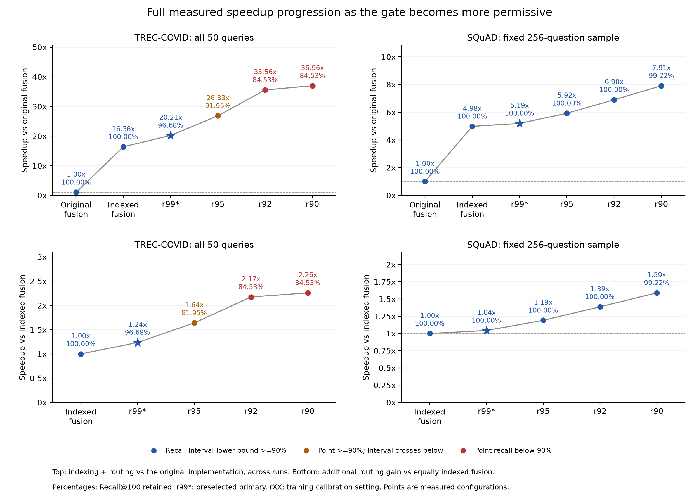

# Project results and next action

Updated 21 October 2026.

The [final research materials](submission/README.md) contain the paper PDF,
offline HTML/PDF showcase and editable presentation for this completed scope.

## Next action

**Use the completed indexed results in the write-up. No new Kaggle run or upload is needed.**
The manuscript now presents the completed studies in one report, with an
updated abstract and conclusion. Every cascade point appears in a growing
speedup figure and in [SPEEDUP_SUMMARY.md](SPEEDUP_SUMMARY.md), including the
largest points that miss 90%. The previous manuscript is preserved in history.

The TREC-COVID ZIP has been received and independently checked. A measured
engineering contribution is now supported: reducing first-stage cost makes
conditional neural skipping save mean time against equally optimized fusion.
The standalone comparisons limit a claim that the cascade is the best choice.

Report-ready wording and reproduction commands are in
[TREC_COVID_INDEXED_FINDINGS.md](findings/TREC_COVID_INDEXED_FINDINGS.md). The manuscript
and claim review include the new findings. Full NQ/HotpotQA remain pending;
this write-up covers the completed experiments without claiming those runs.

## Full speedup progression, including the maximum

**TREC-COVID, all 50 queries.** The original-implementation reference includes
indexing plus routing; the indexed-fusion reference measures the additional
cascade gain. Comparisons to the original implementation span separate runs.

| Configuration | Recall retained | Speedup vs original fusion | Speedup vs indexed fusion |
|:--|--:|--:|--:|
| Indexed fusion | 100.00% | 16.36x | 1.00x |
| r99, primary | 96.68% | 20.21x | 1.24x |
| r95, secondary | 91.95% | 26.83x | 1.64x |
| r92, secondary | 84.53% | 35.56x | 2.17x |
| r90, secondary | 84.53% | 36.96x | 2.26x |

The highest cascade point is shown explicitly: 36.96x over original fusion,
or 2.26x over indexed fusion, retaining 84.53% and failing 90%. The fastest
point with observed retention above 90% reaches 26.83x/1.64x at 91.95%; its
retention interval crosses below 90%, so it remains a secondary point.

On the fixed SQuAD sample, speedup over original fusion grows through
4.98x (indexed fusion), 5.19x (r99), 5.92x (r95), 6.90x (r92) and
7.91x (r90). Additional gains over indexed fusion are 1.04x to 1.59x;
observed retention is 100% to 99.22%. These use the same 256 questions in
both runs, rather than mixing old full-query means with sampled means.

The [complete speedup tables](SPEEDUP_SUMMARY.md) also show every standalone
baseline and the separate 173.78x TREC BM25 scorer ratio. The latter compares
old/new BM25 at unchanged BM25 quality; it is not a cascade or a 90%-of-fusion
recall result. PNG, SVG and CSV exports are under `docs/figures/`.

## Latest verified result: indexed TREC-COVID

All **50 official queries and 171,332 documents**, eight methods, three
warmed randomized timing passes, one T4 session:

| Method | Recall retained | Mean ms | Mean time saved vs indexed fusion |
|:--|--:|--:|--:|
| Indexed static fusion | 100.00% | 91.28 | Reference |
| Nominal 90%, secondary | 84.53% | 40.41 | 55.74% |
| Nominal 92%, secondary | 84.53% | 41.99 | 54.00% |
| Nominal 95%, secondary | 91.95% | 55.66 | 39.02% |
| **Nominal 99%, preselected primary** | **96.68%** | **73.90** | **19.04%** |
| BM25 | 71.38% | 8.11 | 91.11% |
| Dense | 69.81% | 30.41 | 66.68% |
| SPLADE | 104.69% | 52.77 | 42.19% |

The primary's 95% query-bootstrap intervals are **93.58% to 98.75% recall
retained** and **9.47% to 30.11% mean time saved**. It meets the requested
90% floor in this measured setting. It misses its nominal 99% target;
all four nominal calibration targets still fail. Secondary r95's recall
interval crosses below 90%, so its 39.02% saving is a less conservative point.
Primary p95 is 99.41 ms versus fusion's 97.66 ms: the gain is in mean time.

SPLADE alone has higher observed recall and nDCG with lower mean time than
the primary. The cascade has higher MAP@10 (0.01769 versus 0.01662); this is
a quality trade-off, not an overall win. Recall/time alone favor SPLADE at
the user's 90% floor. Do not change the objective after seeing the outcomes.

All 400 first-pass rankings, scores, routes and recalls match the old run
exactly. The 1,200 timings and frozen fingerprints are consistent. Independent
scoring against the exact raw relevance labels reproduces all three quality
metrics for every method. TREC quality was already inspected before this
engineering follow-up; this is not a fresh generalization result.

## Indexed SQuAD: verified sample

The ZIP is received, extracted and checked. Indexed BM25 removes the earlier
execution bottleneck. On **256 fixed-hash questions**, the full 20,958-document
corpus, all eight methods and three warmed T4 timing passes:

| Method | Recall retained | Mean ms | Mean time saved vs indexed fusion |
|:--|--:|--:|--:|
| Indexed static fusion | 100.00% | 29.55 | Reference |
| Cascade nominal 90%, secondary | 99.22% | 18.59 | 37.08% |
| Cascade nominal 92%, secondary | 100.00% | 21.31 | 27.89% |
| Cascade nominal 95%, secondary | 100.00% | 24.82 | 15.99% |
| **Cascade nominal 99%, preselected primary** | **100.00%** | **28.31** | **4.19%** |
| BM25 alone | 95.70% | 1.03 | 96.50% |
| SPLADE alone | 98.83% | 16.96 | 42.61% |
| Dense alone | 95.70% | 10.82 | 63.37% |

The primary time-saving interval is 1.90% to 7.04%. Secondary r90 saves
31.58% to 42.69% mean time and retains 98.05% to 100.00% recall by query
bootstrap. Zero observed recall loss for the other gates is not a guarantee
for unmeasured questions. The measured gain is mean latency; r90's p95 is
31.48 ms versus fusion's 31.37 ms.

**Conclusion:** conditional skipping now gives a meaningful mean time saving
against equally optimized fusion at secondary settings. BM25 alone already
meets a 90% SQuAD quality floor at much lower cost. SPLADE has the highest
nDCG/MAP. The result supports an execution improvement, but does not establish
that the cascade is the best choice for this floor or a major new algorithm.

All 2,048 first-pass rankings match the old run exactly on the same questions,
including scores, routes and per-query recall. All 6,144 query timings are
consistent. Independently reconstructed SQuAD labels reproduce every quality
metric. The selected questions match the declared SHA256 rule. No thresholds,
models, frozen sources or weights were changed.

Details and evidence: [SQUAD_INDEXED_FINDINGS.md](findings/SQUAD_INDEXED_FINDINGS.md).

## Keep execution and quality scopes explicit

On the same 256 questions across the two runs, static fusion falls from
147.01 to 29.55 ms and BM25 from 117.55 to 1.03 ms. Dense and SPLADE times
remain close. These comparisons use one original pass versus three indexed
passes and include between-run variability. The 37.08% saving above compares
cascade and fusion within the new matched indexed experiment.

The earlier full-query SQuAD result covers all 10,570 questions with one
complete timing pass. Its quality is independently verified. The indexed
sample's 100% fusion recall reflects its query selection, not an improvement
caused by indexing. Do not report the sample's quality/time numbers as full
10,570-query indexed results.

## Earlier results remain part of the project

| Original backend dataset | Primary in that study | Recall retained | Mean time saved |
|:--|:--|--:|--:|
| NFCorpus dev, development | Nominal 92% | 94.74% | 23.00% |
| SCIDOCS frozen confirmation | Nominal 92% | 90.01% | 5.53% |
| TREC-COVID frozen extension | Nominal 90% | 84.53% | 3.56% |
| Full SQuAD, one complete pass | Nominal 90% | 99.38% | 6.12% |

All nominal targets miss on SCIDOCS and TREC-COVID. Their original primaries
remain unchanged. On TREC-COVID, secondary r95 retains 91.95% with an interval
crossing below 90%; r99 retains 96.68% but saved only 1.17% using the slow
backend. With indexed execution, the same r99 quality now accompanies a
19.04% mean saving against equally optimized fusion, as reported above.

Dense has better observed recall/time than every cascade on NFCorpus and
SCIDOCS. SPLADE does so on TREC-COVID, while fusion has higher TREC nDCG/MAP.
The MiniLM/SPLADE/RRF system is our adaptation; it is not an exact reproduction
of the original paper's Elasticsearch/ELSER implementation. Full NQ/HotpotQA
are pending and resource dependent. No answer-quality claim has been tested.

## Evidence

- [Indexed SQuAD findings](findings/SQUAD_INDEXED_FINDINGS.md)
- [Full-query SQuAD findings](findings/SQUAD_FINDINGS.md)
- [Indexed TREC-COVID findings](findings/TREC_COVID_INDEXED_FINDINGS.md)
- [Manuscript and addenda](FINAL_MANUSCRIPT.md)
- [Combined metrics, with separate indexed sample label](../cascaded-blended-rag/results/final_quality_speed.csv)

The [original TREC findings](findings/TREC_COVID_FINDINGS.md) and
[results ledger](history/results_ledger.md) preserve the sequence and earlier
unfavorable outcomes. The [local BM25 findings](findings/INDEXED_BM25_FINDINGS.md)
document exact full-score agreement and CPU scorer measurements. Algorithmic
novelty and superiority to modern adaptive retrieval remain unestablished.
