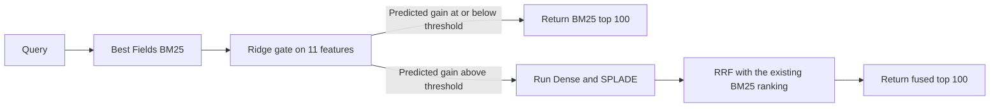
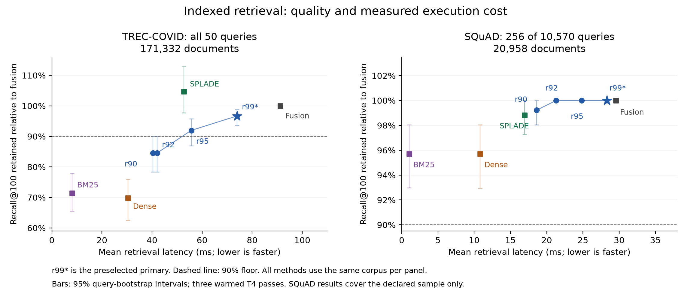

> **Historical document.** This snapshot predates the final presentation release. Read [the current manuscript](../FINAL_MANUSCRIPT.md).

# Conditional Hybrid Retrieval: Execution Cost, Recall Budgets and Standalone Baselines

Project manuscript, consolidated 21 October 2026. This report covers the
completed experiments. It makes no claim of a new routing principle, a new
BM25 algorithm or an exact reproduction of the original Blended RAG system.

## Abstract

Conditional hybrid retrieval can avoid neural computation when lexical
retrieval already supplies a useful ranking. We evaluate a BM25-first Ridge
gate trained on NFCorpus train and calibrated at nominal recall-retention
settings of 90%, 92%, 95% and 99%. Initial experiments expose failed target
transfer and an expensive first stage. We then implement compatible BM25
postings and apply them equally to fusion, standalone BM25 and all cascades.
On all 50 TREC-COVID queries, indexing reduces fusion mean latency from
1493.23 to 91.28 ms across runs. Additional routing yields 1.24x to 2.26x
speedup over indexed fusion, retaining 96.68% to 84.53% of its Recall@100.
The fastest secondary point with observed retention above 90% reaches 1.64x
at 91.95%; its recall interval crosses below 90%. The conservative primary
reaches 1.24x at 96.68%, with a retention interval of 93.58% to 98.75%.
On a declared 256-question SQuAD sample, cascade speedup grows from 1.04x to
1.59x, retaining 100% to 99.22% recall. Independent raw-label scoring and
exact old/new ranking agreement support these measurements. Strong constant
baselines remain: SPLADE offers a better recall/time point on TREC, while
BM25 already clears the 90% floor on SQuAD. The study demonstrates execution
improvement and conditional quality/time trade-offs within the measured
implementation; it does not establish overall method superiority.

## 1. Research question and contribution

A retrieval cascade is useful only when the computation it avoids exceeds
the cost paid before its decision. We investigate that condition for a
lexical first stage followed by Dense and SPLADE retrieval. The objective is
to preserve a chosen fraction of fusion recall while reducing actual query
latency, including routing and query encoding.

The project contributes a reproducible evaluation and a compatible execution
optimization. It studies four frozen quality budgets, measures their transfer
failures, checks that indexing preserves results, and compares conditional
execution with equally indexed fusion and standalone retrievers. The largest
speedup is reported together with its observed quality and comparison
baseline. Branch-skipping counts alone do not establish an efficiency gain.

## 2. Related work and relationship to Blended RAG

Blended RAG evaluates keyword, dense and learned sparse retrieval with hybrid
queries, including Best Fields search and ELSER. Its experiments include
TREC-COVID and SQuAD. Our MiniLM/SPLADE/RRF system adapts that retrieval
setting; its models, engine and SQuAD paragraph construction differ from the
paper. Our runtime comparisons concern our own implementation. They do not
measure acceleration of the original paper's system.
[Blended RAG](https://arxiv.org/html/2404.07220v2).

Retrieval strategy selection already has prior work: Arabzadeh et al. train
a classifier to choose sparse, dense or hybrid retrieval per query. Eager
sparse scoring also predates this project; BM25S computes term contributions
during indexing. These precedents limit a novelty claim based on gating or
precomputation alone. This report supplies measurements of the specific
frozen cascade, its compatible execution change and its remaining baseline
limits. [Strategy selection](https://arxiv.org/abs/2109.10739),
[BM25S](https://arxiv.org/abs/2407.03618).

## 3. Method

### 3.1 Retrieval actions

The static reference executes Best Fields BM25, Dense MiniLM
(`sentence-transformers/all-MiniLM-L6-v2`) and SPLADE
(`naver/splade-cocondenser-ensembledistil`). BM25 scores title and abstract
fields separately and takes their maximum. Each branch contributes 100
results to reciprocal rank fusion, which sums `1 / (60 + rank)` and returns
100 documents. The confirmation and paper-dataset runners request 101
candidates, remove an identical query/document ID and keep 100 before
features or fusion. Actual ID overlap is zero on the reported confirmations.

The cascade always executes BM25 first. A gate then chooses between returning
that ranking and running both neural branches before the same fusion.
Fallback retrieval reuses that query's BM25 ranking. Timed methods do not
share neural query rankings or precomputed query results.



### 3.2 Gate and calibration

The original 11 features describe query length, term specificity and the
BM25 score distribution. They include token and unique-token counts;
top-one and top-two scores, their gap, the top-ten mean and standard
deviation, and top-one score per query token; plus maximum, mean and standard
deviation of query-term IDF. Exact definitions and feature order remain in
experiment 12 and the exported router artifact.

A standardized Ridge regressor with alpha 10 predicts
`g(q) = max(Recall_static(q) - Recall_BM25(q), 0)`.
Inference clips negative predictions to zero. The gate exits when its
prediction is at or below the selected threshold. For target `t`, calibration
limits the sum of observed clipped losses on selected exits to
`(1 - t) * sum_q Recall_static(q)`. Favorable BM25 differences do not offset
losses during this calibration procedure.

Thresholds use five-fold out-of-fold predictions on all 2,590 NFCorpus train
queries, with seed 42; the exported model then fits all training queries.
Earlier nested comparisons use five outer folds and four inner folds.
A 69-feature coverage ablation remains development evidence; the original
11-feature model is frozen for confirmation. This empirical calibration
procedure provides no distribution-free guarantee on later collections.

### 3.3 Compatible BM25 execution

The original Python scorer repeatedly visits document term-frequency
structures. The revised scorer precomputes per-term field contributions
into postings and uses partitioning with a corpus-order tie rule to select
the top results. It preserves tokenization, epsilon-adjusted IDFs, field
normalization, duplicate query-token contributions and float64 accumulation
order. Both reference fusion and all cascades receive the change.

Local CPU comparisons verify identical full score vectors and top-100
rankings on 50 TREC queries and 2,590 NFCorpus train queries. The separate
Kaggle follow-ups verify every method's saved top-100 IDs, scores, routes and
recalls against the original runs. This lets us attribute changed runtime
to execution while retaining the same measured retrieval behavior.

## 4. Experimental protocol

### 4.1 Collections and evaluation scope

NFCorpus, SCIDOCS and TREC-COVID use BEIR distributions, retaining their full
corpora. BEIR supplies a heterogeneous retrieval benchmark; the split and
inspection status of each project run are specified below.
[BEIR](https://arxiv.org/abs/2104.08663).

**Table 1. Completed evaluation contexts. Full corpora are retained in every row.**

| Study | Queries evaluated | Documents | Complete timing passes | Primary in that study |
|:--|--:|--:|--:|:--|
| NFCorpus dev, inspected development | 324 | 3,633 | 3 | r92 |
| SCIDOCS official test, frozen confirmation | 1,000 | 25,657 | 3 | r92 |
| Original TREC-COVID | 50 | 171,332 | 3 | r90 |
| Original SQuAD paragraph retrieval | 10,570 | 20,958 | 1 | r90 |
| Indexed TREC-COVID follow-up | All 50 | 171,332 | 3 | r99 against 90% floor |
| Indexed SQuAD follow-up | 256 of 10,570 | 20,958 | 3 | r99 against 90% floor |

The SQuAD corpus contains all unique title/paragraph pairs from official
SQuAD 1.1 train and dev data. Dev questions query the corpus; the annotated
parent paragraph is relevant and alternative answer-bearing paragraphs are
unjudged. This is retrieval evaluation rather than answer EM/F1. The original
long timing job was shortened before quality scoring after one complete pass
and 4,649 additional query repetitions. The complete pass supplies its means;
additional records remain separate and do not establish three-pass stability.

The indexed SQuAD sample is the first 256 query IDs after sorting by
SHA256(`squad` + NUL + query ID), as declared before its outcomes. Its quality
and timing apply to that sample. Full-query original SQuAD quality must not
be substituted for indexed sample metrics. Full NQ/HotpotQA evaluation
remains pending and resource dependent; earlier qrel-informed NQ simulations
and historical SciFact runs do not strengthen this report's main claims.

### 4.2 Fixed decisions and inspection status

Weights and thresholds use NFCorpus train only. NFCorpus dev had already
been inspected; the r92 model/threshold and confirmation protocol were frozen
before SCIDOCS outcomes. NFCorpus test had been inspected earlier and is
excluded from this calibration and confirmation sequence.

The original paper-dataset extension declared r90 primary before its outcomes.
The indexed engineering follow-up declared the existing conservative r99
policy primary against a 90% floor, using already-inspected NFCorpus/SCIDOCS/
TREC evidence before indexed outcomes and current full-SQuAD outcome
inspection. Earlier studies retain their original primaries. All four
settings remain reported. The indexed TREC result is an engineering
follow-up on known quality, rather than a new independent generalization test.

### 4.3 Timings, metrics and comparison references

Kaggle measurements use a Tesla T4, one CPU thread, randomized query/method
ordering, warmups and GPU synchronization around each timed query. Timings
include query retrieval and routing, while excluding corpus encoding,
index preparation, model loading, dataset download and answer generation.
Three passes are complete except for the explicitly amended original SQuAD
run. Datasets and backend runs have separate sessions.

Recall retention is `mean Recall_method@100 / mean Recall_fusion@100`.
It measures relative retrieval quality and can exceed 100%; it does not
represent overlap of retrieved lists or a per-query guarantee. nDCG@10 and
MAP@10 report ranking quality. Query-paired bootstrap intervals use 1,000
resamples and repeat-averaged query times, without covering all hardware or
session variation. Count-matched random routing supplies an offline recall
reference with 200 assignments, not a timed system.

We report two speedup references. Original-fusion latency divided by indexed
method latency describes indexing and routing combined, across runs.
Indexed-fusion latency divided by indexed-cascade latency describes the
additional conditional-routing gain with the same scorer. SQuAD cross-run
comparisons use the exact same 256 questions. Percent time saved is
`1 - 1/speedup`; a 1.24x speedup corresponds to 19.04% less mean time here.

## 5. Results

### 5.1 Full speedup progression


**Figure 1.** Every cascade setting, ordered from conservative to more
permissive. Top panels compare with the original implementation; bottom
panels compare with equally indexed fusion. Percentages beside points are
Recall@100 retained. Colors distinguish a failed 90% point, a point above
90% whose interval crosses below it, and an interval lower bound above 90%.
These are measured configurations, not evidence of scaling to larger corpora.

On TREC, indexing alone changes fusion from 1493.23 to 91.28 ms, an observed
16.36x cross-run speedup. Indexing plus r99/r95/r92/r90 reaches
20.21x/26.83x/35.56x/36.96x relative to original fusion, retaining
96.68%/91.95%/84.53%/84.53% recall. The largest two points fail the requested
90% floor. The 26.83x secondary point clears 90% at its observed mean but
has a recall interval crossing below that floor. These larger ratios include
the backend change and must not all be attributed to routing.

On the same SQuAD sample, indexed fusion reaches 4.98x over original fusion.
The four cascade settings then reach 5.19x, 5.92x, 6.90x and 7.91x, retaining
100%, 100%, 100% and 99.22% recall. The comparisons use one original timing
pass versus three indexed passes. Complete tables, including the faster
standalone baselines, are in [SPEEDUP_SUMMARY.md](../SPEEDUP_SUMMARY.md).

### 5.2 Indexed TREC-COVID

**Table 2. All 50 TREC queries and the full corpus; the reference is equally indexed fusion.**

| Method | Recall retained | nDCG@10 | MAP@10 | Mean ms | Speedup vs indexed fusion |
|:--|--:|--:|--:|--:|--:|
| Indexed fusion | 100.00% | 0.76323 | 0.01861 | 91.28 | 1.00x |
| BM25 | 71.38% | 0.54969 | 0.01145 | 8.11 | 11.25x |
| Dense | 69.81% | 0.47254 | 0.01054 | 30.41 | 3.00x |
| SPLADE | 104.69% | 0.72899 | 0.01662 | 52.77 | 1.73x |
| r99 (primary) | 96.68% | 0.72281 | 0.01769 | 73.90 | 1.24x |
| r95 (secondary) | 91.95% | 0.70561 | 0.01742 | 55.66 | 1.64x |
| r92 (secondary) | 84.53% | 0.65315 | 0.01499 | 41.99 | 2.17x |
| r90 (secondary) | 84.53% | 0.65115 | 0.01499 | 40.41 | 2.26x |

The preselected r99 primary yields 1.24x speedup, retaining 96.68% recall.
Its mean time saving is 19.04% with a query-bootstrap interval of 9.47% to
30.11%; its retention interval is 93.58% to 98.75%. Both lower bounds pass
the follow-up's positive-saving and 90%-retention criteria in this setting.
The primary exits on 11 queries, avoiding 33 invocations of each neural
branch across three passes. It still misses its nominal 99% calibration
label, as do all other nominal TREC targets.

The fastest secondary cascade point with observed retention above 90% is
r95: 1.64x speedup at 91.95% retained. Its recall interval is 86.88% to
95.76%, and its time-saving interval is 26.54% to 51.94%. The absolute maximum
cascade speedup is 2.26x at r90, retaining 84.53%; r92 also fails 90%. These
points remain visible without replacing the preselected primary.

SPLADE alone reaches 1.73x speedup, retaining 104.69% of fusion recall. It
has higher recall and nDCG with lower mean time than the primary. The primary
has higher MAP, 0.01769 versus 0.01662, a descriptive relative difference of
6.43% without a significance claim. Under a recall/time objective SPLADE
remains the stronger constant choice. This MAP difference cannot justify
changing the original objective retrospectively to establish superiority.

Primary absolute Recall@100 is 0.11844 versus fusion's 0.12250; many documents
are judged relevant per TREC topic. The 96.68% figure is a retention ratio.
Primary p95 is 99.41 ms versus fusion's 97.66 ms, so the measured mean gain
does not establish a p95 improvement.

### 5.3 Indexed SQuAD sample

**Table 3. The fixed 256-question sample, full corpus and three timing passes.**

| Method | Recall retained | nDCG@10 | MAP@10 | Mean ms | Speedup vs indexed fusion |
|:--|--:|--:|--:|--:|--:|
| Indexed fusion | 100.00% | 0.80931 | 0.77059 | 29.55 | 1.00x |
| BM25 | 95.70% | 0.77869 | 0.75038 | 1.03 | 28.59x |
| Dense | 95.70% | 0.68778 | 0.63040 | 10.82 | 2.73x |
| SPLADE | 98.83% | 0.85440 | 0.82831 | 16.96 | 1.74x |
| r99 (primary) | 100.00% | 0.81020 | 0.77082 | 28.31 | 1.04x |
| r95 (secondary) | 100.00% | 0.80277 | 0.76464 | 24.82 | 1.19x |
| r92 (secondary) | 100.00% | 0.80287 | 0.76757 | 21.31 | 1.39x |
| r90 (secondary) | 99.22% | 0.80092 | 0.76757 | 18.59 | 1.59x |

Additional cascade speedup grows from 1.04x at r99 to 1.19x, 1.39x and 1.59x
as the nominal setting becomes more permissive. Observed recall retention is
100% at the first three points and 99.22% at r90. The primary's mean saving
is 4.19% (interval 1.90% to 7.04%). Secondary r90 saves 37.08% (31.58% to
42.69%) and retains 99.22% (98.05% to 100%). The primary remains r99.

BM25 alone retains 95.70% at 1.03 ms, reaching 28.59x speedup over indexed
fusion; it is the fastest listed method meeting the user's 90% floor here.
SPLADE has the highest nDCG and MAP at 16.96 ms, while retaining 98.83%
recall. These baselines limit a claim of practical cascade superiority.
Zero sampled losses and empirical intervals of [1, 1] at r92/r95/r99 do not
guarantee zero loss on unmeasured questions. r90 p95 is 31.48 ms versus
fusion's 31.37 ms, so a tail-latency improvement is not shown.

### 5.4 Earlier calibration and original-backend findings

**Table 4. Original study primaries, kept separate from indexed study selection.**

| Original backend study | Primary setting | Recall retained | Fusion mean ms | Cascade mean ms | Mean time saved |
|:--|:--|--:|--:|--:|--:|
| NFCorpus dev | r92 | 94.74% | 23.61 | 18.18 | 23.00% |
| SCIDOCS test | r92 | 90.01% | 159.51 | 150.69 | 5.53% |
| TREC-COVID | r90 | 84.53% | 1493.23 | 1440.00 | 3.56% |
| SQuAD full queries, one pass | r90 | 99.38% | 148.26 | 139.19 | 6.12% |

All nominal targets pass on NFCorpus dev and full-query SQuAD. All fail on
SCIDOCS and TREC. SCIDOCS r92's retention interval, 88.27% to 91.61%, crosses
90%; the original TREC r90 point fails even at its observed 84.53% retention.
No recalibration follows these results. The original full-query SQuAD result
has one complete timing pass, despite its 10,570-query quality coverage.

Dense has higher recall and lower time than every cascade on NFCorpus dev
and SCIDOCS. It retains 99.77% of fusion recall at 6.62 ms on NFCorpus; on
SCIDOCS it retains 109.65% at 10.14 ms and leads all three quality metrics.
These outcomes remain part of the project. Per-policy original-backend
values, the development feature ablation and random-assignment references
remain in the detailed findings and combined machine-readable table.

### 5.5 Compatibility and component execution

All 400 TREC and 2,048 sampled SQuAD first-pass rankings match the original
runs exactly: document IDs and order, scores, routes and per-query recalls.
Maximum saved-ranking score difference is zero. Independent raw-label
scoring reproduces all three aggregate quality metrics for every method on
both indexed collections and on original full-query SQuAD/TREC.

Across TREC pipeline runs, BM25 alone changes from 1410.14 to 8.11 ms, an
observed 173.78x scorer ratio. Dense and SPLADE standalone means remain
close. This scorer result preserves BM25 quality; BM25 still retains only
71.38% of fusion recall. The larger scorer ratio is not an end-to-end cascade
speedup. Separate paired local CPU measurements show 134.85x scorer speedup
on TREC and 34.59x on NFCorpus train, with identical full score vectors.
Those measurements have different hardware and scope.



**Figure 2.** Mean query time and recall retention for all indexed methods.
The complete reference corpus is common within each panel. Error bars are
95% query-bootstrap intervals. The SQuAD panel is a declared sample.

## 6. Discussion and limits

First-stage cost controls how much a gate can save. On original TREC, BM25
alone consumes 1410.14 ms against fusion's 1493.23 ms. After compatible
indexing, that first stage takes 8.11 ms and the same gate can avoid a larger
fraction of the remaining query cost. The study changes reference and
proposed method together, rather than giving the execution improvement only
to the cascade. Original/indexed comparisons are separate runs, so their
ratios include run variability.

Training calibration does not ensure transfer. Identical rankings after
indexing preserve the original quality misses, while the indexed primary
choice uses already-inspected evidence. The work supports an engineering
follow-up, not a new independent guarantee. Standalone quality/time comparisons
also matter: fusion itself need not be the most efficient useful action.

The measurements cover one GPU type, small numbers of timing sessions and
prepared indexes. They exclude production concurrency, energy, memory/update
cost and generated answers. We have not measured modern adaptive retrieval
baselines, full NQ/HotpotQA or the original paper's ELSER implementation.
Method novelty, publication competitiveness and overall superiority remain
unestablished. A future method study should define its quality/cost objective
on training and validation data before evaluating new independent queries.

## 7. Conclusion

Compatible indexing makes conditional neural skipping deliver larger mean
savings against an equally optimized fusion reference. TREC cascade speedup
ranges from 1.24x to 2.26x while recall retention declines from 96.68% to
84.53%. Its fastest secondary point above 90% observed retention reaches
1.64x at 91.95%, with uncertainty crossing the floor; the conservative primary
retains 96.68% at 1.24x. Against our original fusion implementation, indexing
and routing together reach 26.83x at that 91.95% secondary point and 36.96x
at the 84.53% point. On sampled SQuAD, the cascade reaches 1.59x over indexed
fusion at 99.22% retention. Strong constant baselines remain preferable under
the recall/time objective on these datasets. The contribution is a measured
execution optimization and empirical analysis of its quality/time limits.

## 8. Reproducibility and evidence

All paths below are relative to `cascaded-blended-rag/` unless linked.
`results/final_quality_speed.csv` contains the combined measurements with
separate sample/full-query labels. `results/indexed_trec-covid_q0/` contains
all-query TREC evidence; q0 means all queries. SQuAD indexed evidence is
under `results/indexed_squad_q256/`; original full-query data are under
`results/paper_squad_one_pass/`. Original TREC, NFCorpus dev and SCIDOCS
reports remain in their named result directories. The chronological ledger
preserves decisions and earlier unfavorable outcomes.

Experiments 22, 29, 30 and 31 validate saved artifacts, independently score
raw labels where available, and compare old/new rankings. Experiment 32
exports both figures and the complete speedup tables without retrieval,
training or new timing. Frozen weights SHA256 is
`3efd7382cd91cfc43bd7ae5d4eaf27571ae92657dec97e3eaf85fbb36131a5d1`;
indexed runner SHA256 is
`ddb7b5656ed20e0ab20cb2199f544137e3679c161b99cb935c5f14919e44a104`.
Model revisions and all other source hashes remain in the frozen protocols.

Local figure/table regeneration, from the workspace root:

```powershell
& '.\cascaded-blended-rag\venv\Scripts\python.exe' '.\cascaded-blended-rag\experiments\32_prepare_report_assets.py'
```

[Full speedup tables](../SPEEDUP_SUMMARY.md),
[indexed TREC findings](../findings/TREC_COVID_INDEXED_FINDINGS.md),
[indexed SQuAD findings](../findings/SQUAD_INDEXED_FINDINGS.md),
[claim-evidence audit](../review/FINAL_WRITING_AUDIT.md) and
[results ledger](results_ledger.md) provide supporting detail. The previous
addendum-based manuscript is preserved in `docs/history/`.

## Answered self-review

1. **Contribution:** measured compatible execution improvement and conditional
   savings are supported. The report makes no new-principle or SOTA claim.
2. **Clarity:** both speedup references, every gate, observed retention,
   primary/secondary status and sample/full-query scopes are explicit.
3. **Experimental strength:** repeated execution, compatible saved rankings
   and independent metric reproduction support the measured result. Limited
   hardware/sessions and inspected-data selection restrict inference.
4. **Evaluation completeness:** strong constant baselines and unfavorable
   targets remain visible. Adaptive SOTA, answer generation and two large
   original-paper datasets remain unevaluated within this completed scope.
5. **Method soundness:** static and cascade methods share the optimization.
   The fastest point below 90% is never presented as satisfying that floor,
   and the secondary 91.95% point retains its interval caveat. Overall method
   superiority remains unestablished.
